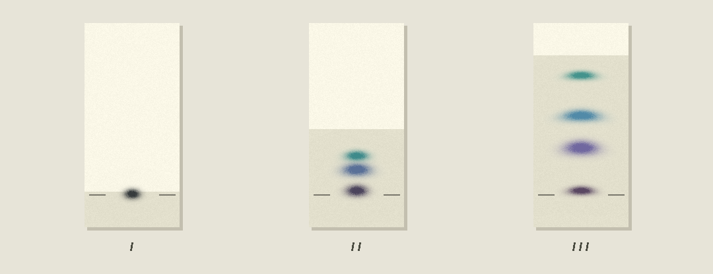

# What is in a drop of black ink?

I put a dot of black ink on a coffee filter and dipped the bottom edge into water. A few minutes later, a blue-green rim appeared above the dot.

## Mark the starting line

Draw a pencil line near the bottom of a paper strip. Place a dot of water-based black ink on it. Keep the water below the dot so the ink stays on the paper instead of spilling into the cup.

## Mark where the water stopped

When the water approaches the top, lift the strip out and mark the wet edge in pencil. It almost disappears as the paper dries. The drawing shows one strip at three moments. Try another pen and you may get a different set of colours.
