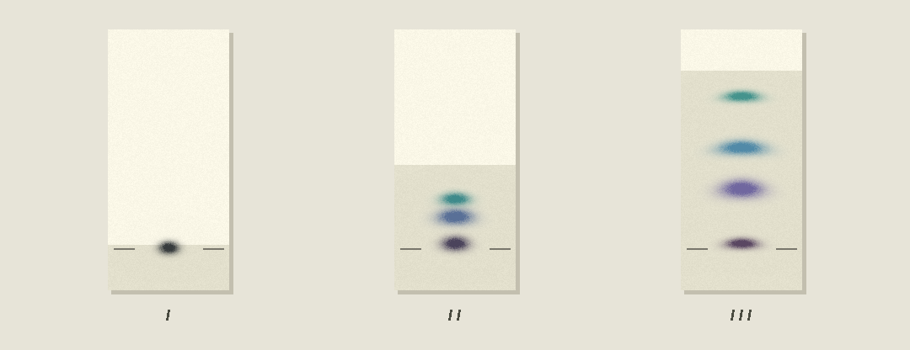

# 一滴黑墨水里有什么？

我在咖啡滤纸上点了一个黑点，把纸的下沿浸进清水。几分钟后，黑点上方多出了一道蓝绿色的边。

## 记下起点

用铅笔在纸条底部画一条线，再用水性黑笔在线上点一下。水面要低于墨点，否则墨水会先散进杯子里。

## 画下水走到哪里

水快到纸条顶端时，取出纸条，立刻用铅笔标出湿润的边界。等纸晾干，这条边界就很难找到了。图里是同一条纸带在三个时刻的示意；换一支笔，留下的颜色也可能不同。
