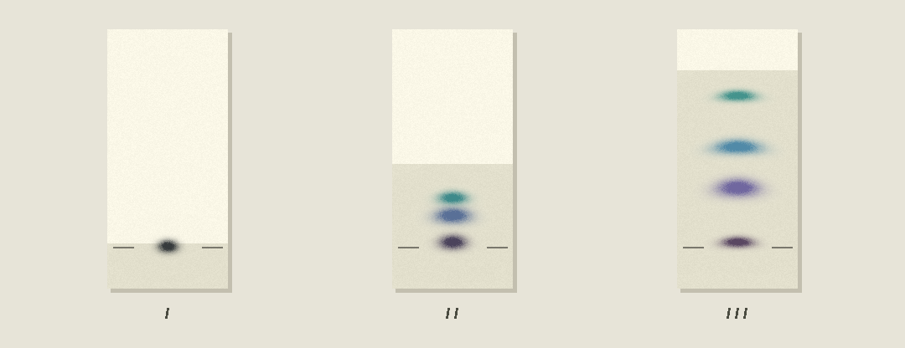

# 黒いインクの一滴には何が入っている？

コーヒーフィルターに黒い点を打ち、紙の下端を水に浸した。数分たつと、点の上に青緑色の縁が現れた。

## 出発点に印をつける

細く切った紙の下のほうに鉛筆で線を引き、その上に水性の黒ペンで点を一つ打つ。インクがコップの水に流れ出さないよう、水面は点より下にしておく。

## 水が届いたところを記す

水が紙の上端近くまで来たら、紙を取り出し、濡れた部分の境目にすぐ鉛筆で印をつける。乾いてしまうと境目はほとんど見えない。図は一本の紙の変化を三段階で示したもの。同じ黒でも、ペンを替えると違う色が現れることがある。
